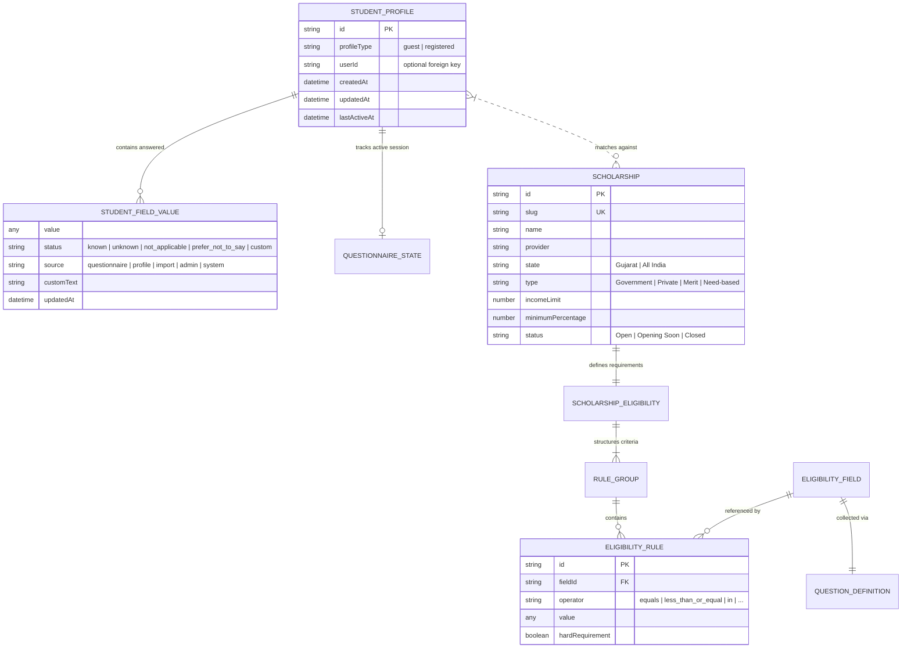

# EDVORA — Comprehensive Data Dictionary
**AI-Powered Scholarship Finder & Document Assistant**  
*Document Version: 1.0.0 | Release: Production | Date: September 2026*

---

## 1. Executive Summary & Document Overview

This **Data Dictionary** provides complete, authoritative technical specifications for all data entities, schemas, storage repositories, registries, and business rules implemented across **Edvora**.

### 1.1 Architecture & Storage Paradigm
Edvora implements a **Privacy-First, Client-Centric & Relational Hybrid Architecture**:
- **Client Storage (`localStorage` & `sessionStorage`)**: Primary source of truth for student answers, adaptive questionnaire session states, bookmarked scholarships, and comparison trays. No cloud registration or PII is required.
- **Embedded Database (`SQLite` via `better-sqlite3`)**: Master catalog of verified scholarships, eligibility rules, and administrative records with Write-Ahead Logging (WAL) concurrency.
- **Universal Field & Question Registries**: Strongly-typed declarative dictionaries driving the Candidate Engine, Eligibility Rule Engine, and Adaptive Questionnaire.

---

## 2. High-Level Entity-Relationship (ER) Architecture



---

## 3. Relational Database Schema (`database/edvora.sqlite`)

Stored locally on disk at `database/edvora.sqlite`. Managed by `server/db.cjs` and the Vite embedded middleware.

### 3.1 Table: `scholarships`
Master repository of all verified national and state scholarship schemes.

| Column Name | SQLite Type | Nullable | Primary Key | Constraints / Default | Description & Business Purpose |
|---|---|:---:|:---:|---|---|
| `id` | `TEXT` | No | **PK** | Unique Identifier | Primary machine identifier (e.g. `mysy-scheme`, `cmss-gujarat`). |
| `slug` | `TEXT` | No | No | `UNIQUE` Index | URL-safe slug for clean routing (e.g. `/scholarships/mysy-scheme`). |
| `name` | `TEXT` | No | No | Non-empty | Full official title of the scholarship. |
| `short_name` | `TEXT` | No | No | Non-empty | Concise display acronym (e.g. `MYSY Gujarat`, `CMSS`). |
| `provider` | `TEXT` | No | No | Non-empty | Sponsoring organization / Government department. |
| `state` | `TEXT` | No | No | Index | Applicable territory (`'Gujarat'` or `'All India'`). |
| `type` | `TEXT` | No | No | Enum-like string | Classification (`'Government'`, `'Private'`, `'Merit'`, etc.). |
| `education_levels` | `TEXT` | No | No | JSON Array string | Target levels (e.g. `["Diploma", "Undergraduate"]`). |
| `courses` | `TEXT` | No | No | JSON Array string | Covered course streams or `["All"]`. |
| `categories` | `TEXT` | No | No | JSON Array string | Social quotas (e.g. `["General", "SEBC/OBC", "EWS"]` or `["All"]`). |
| `gender_eligibility` | `TEXT` | No | No | `'All'`, `'Female'`, `'Male'` | Gender restrictions. |
| `income_limit` | `REAL` | **Yes** | No | $\ge 0$ or `NULL` | Ceiling on annual family income (in INR). `NULL` if no limit. |
| `minimum_percentage` | `REAL` | **Yes** | No | 0.0 to 100.0 or `NULL` | Minimum qualifying marks percentage required. |
| `year_eligibility` | `TEXT` | No | No | JSON Array string | Academic years covered (e.g. `["1st Year", "All"]`). |
| `special_conditions` | `TEXT` | **Yes** | No | JSON Object string | PwD percentage, orphan status, minority flags, notes. |
| `benefits` | `TEXT` | No | No | JSON Object string | Financial coverage (`amountDescription`, `hostelAllowance`, etc.). |
| `application_start` | `TEXT` | No | No | ISO Date string | Opening date of portal (`YYYY-MM-DD`). |
| `application_deadline` | `TEXT` | No | No | ISO Date string | Submission cut-off date (`YYYY-MM-DD`). |
| `status` | `TEXT` | No | No | Index | Current status: `'Open'`, `'Opening Soon'`, `'Closed'`. |
| `documents` | `TEXT` | No | No | JSON Array string | List of required documentary certificates. |
| `description` | `TEXT` | No | No | Non-empty text | Brief summary of the scheme purpose and scope. |
| `who_can_apply` | `TEXT` | No | No | JSON Array string | Plain-language student eligibility summary bullet points. |
| `how_to_apply_steps` | `TEXT` | No | No | JSON Array string | Step-by-step submission instructions. |
| `official_website` | `TEXT` | No | No | Valid URL | Informational official authority portal link. |
| `application_website` | `TEXT` | No | No | Valid URL | Direct portal URL where applications are accepted. |
| `last_updated` | `TEXT` | No | No | ISO Date string | Timestamp of last rule audit and verification. |
| `tags` | `TEXT` | No | No | JSON Array string | Search optimization keywords and category tags. |
| `is_verified` | `INTEGER` | No | No | `DEFAULT 1` | Boolean flag (1=Verified official source, 0=Draft/Review). |
| `is_featured` | `INTEGER` | No | No | `DEFAULT 0` | Boolean flag (1=Promoted on homepage hero section). |
| `created_at` | `DATETIME` | No | No | `CURRENT_TIMESTAMP` | System record creation timestamp. |

---

## 4. Client Storage Schema & Persistence Envelopes

To maintain high data integrity and prevent schema breakage during upgrades, client-side data is encapsulated in versioned structures.

### 4.1 Storage Catalog

| Storage Key | Engine | Data Type | Expiry / Lifecycle | Description |
|---|---|---|---|---|
| `edvora_student_profile_v1` | `localStorage` | `StoredProfileEnvelope` | Persistent across sessions | Complete student profile, answer dictionary, and readiness. |
| `edvora_questionnaire_state_v1` | `localStorage` | `StoredQuestionnaireEnvelope` | Persistent | Active adaptive questionnaire progress, stack, and asked IDs. |
| `edvora_saved_ids` | `localStorage` | `string[]` (JSON) | Persistent | Bookmarked scholarship IDs chosen by the student. |
| `edvora_recent_ids` | `localStorage` | `string[]` (JSON) | Persistent | Last viewed scholarship slugs (capped at 10 items). |
| `edvora_compare_ids` | `localStorage` | `string[]` (JSON) | Persistent | IDs loaded in the comparison tray (maximum 3 items). |
| `edvora_lang` | `localStorage` | `'en' \| 'hi' \| 'gu'` | Persistent | Selected interface localization language. |
| `theme` | `localStorage` | `'light' \| 'dark' \| 'system'` | Persistent | Active color scheme preference. |
| `edvora_find_search_prefs` | `sessionStorage` | `SearchPreferences` | Tab / Session only | Temporary query, category, and location filters on `/find`. |

---

### 4.2 Envelope Data Models

#### `StoredProfileEnvelope`
```typescript
interface StoredProfileEnvelope {
  version: 1;                     // Schema version identifier
  storedAt: string;               // ISO 8601 timestamp of persistence
  profile: StudentProfile;        // Core profile model
}
```

#### `StudentProfile`
```typescript
interface StudentProfile {
  id: string;                     // Unique profile ID (e.g. "guest_1726892834")
  profileType: 'guest' | 'registered';
  userId?: string;                // Optional link for future registered user
  createdAt: string;              // ISO 8601 creation timestamp
  updatedAt: string;              // ISO 8601 last update timestamp
  lastActiveAt?: string;          // ISO 8601 timestamp
  fields: Record<string, StudentFieldValue>;
  preferences: {
    language: 'en' | 'hi' | 'gu';
    theme: 'light' | 'dark' | 'system';
    desiredSupportTypes?: string[];
  };
  profileCompletion?: {
    percentage: number;           // 0 to 100
    knownFields: number;          // Total fields answered with 'known' status
    relevantFields: number;       // Relevant fields relative to candidates
  };
}
```

#### `StudentFieldValue`
```typescript
interface StudentFieldValue {
  value: string | number | boolean | string[] | null;
  status: 'known' | 'unknown' | 'not_applicable' | 'prefer_not_to_say' | 'custom';
  updatedAt: string;              // ISO 8601 timestamp
  source: 'questionnaire' | 'profile' | 'import' | 'admin' | 'system';
  customText?: string;            // Retains write-in option when status is 'custom'
}
```

#### `QuestionnaireState`
```typescript
interface QuestionnaireState {
  sessionId: string;              // UUID of the current active session
  profileId: string;              // Target profile ID
  startedAt: string;              // ISO 8601 timestamp
  completedAt?: string;           // ISO 8601 timestamp
  currentQuestionId?: string;     // ID of the question currently on screen
  askedQuestionIds: string[];     // Questions already answered in this session
  skippedQuestionIds: string[];   // Questions deferred by the user
  answers: Record<string, StudentFieldValue>;
  candidateScholarshipIds: string[];
  missingFieldIds: string[];
  status: 'not_started' | 'in_progress' | 'completed' | 'paused';
}
```

---

## 5. Universal Eligibility Field Registry (`src/data/eligibility/fields.ts`)

Standardized field dictionary categorizing all 65+ discoverable student attributes.

### 5.1 Category: Demographic
| Field ID | Key | Data Type | Weight (1-10) | Discoverable | Validation & Allowed Values | Description |
|---|---|---|:---:|:---:|---|---|
| `field_age` | `age` | `number` | 5 | Yes | Min: 3, Max: 100 | Age in completed years. |
| `field_date_of_birth` | `dateOfBirth` | `date` | 4 | Yes | ISO Date string | Official date of birth. |
| `field_gender` | `gender` | `single_select` | 8 | Yes | `female`, `male`, `transgender`, `other` | Gender identity. |
| `field_nationality` | `nationality` | `single_select` | 7 | Yes | `indian`, `nri`, `foreign_national` | Citizenship. |
| `field_religion` | `religion` | `single_select` | 6 | Yes | `hindu`, `muslim`, `christian`, `sikh`, `buddhist`, `jain`, `parsi`, `other` | Religious community for minority schemes. |
| `field_minority_community` | `minorityCommunity` | `boolean` | 8 | Yes | `true`, `false` | Belonging to notified religious minority. |
| `field_marital_status` | `maritalStatus` | `single_select` | 4 | Yes | `unmarried`, `married`, `divorced`, `widowed` | Marital status. |
| `field_single_girl_child` | `singleGirlChild` | `boolean` | 7 | Yes | `true`, `false` | Only girl child of parents (Pragati schemes). |
| `field_is_first_graduate` | `isFirstGraduate` | `boolean` | 5 | Yes | `true`, `false` | First generation higher education applicant. |

---

### 5.2 Category: Location & Domicile
| Field ID | Key | Data Type | Weight (1-10) | Discoverable | Validation & Allowed Values | Description |
|---|---|---|:---:|:---:|---|---|
| `field_domicile_state` | `domicileState` | `single_select` | **10** | Yes | `gujarat`, `other_state` | State where official domicile certificate is held. |
| `field_current_state` | `currentState` | `single_select` | 8 | Yes | `gujarat`, `maharashtra`, `rajasthan`, `delhi`, `karnataka`, `other_state` | State of current physical residence. |
| `field_permanent_state` | `permanentState` | `single_select` | 8 | Yes | Indian State names | Permanent home state. |
| `field_domicile_district` | `domicileDistrict` | `text` | 2 | Yes | Valid district name | District of domicile certificate. |
| `field_rural_urban` | `ruralUrban` | `single_select` | 4 | Yes | `rural`, `urban`, `semi_urban` | Area demographic classification. |
| `field_pincode` | `pincode` | `text` | 2 | Yes | 6-digit Indian PIN | Postal area code. |

---

### 5.3 Category: Education Level & Course
| Field ID | Key | Data Type | Weight (1-10) | Discoverable | Validation & Allowed Values | Description |
|---|---|---|:---:|:---:|---|---|
| `field_education_level` | `educationLevel` | `single_select` | **10** | Yes | `school`, `diploma`, `iti`, `undergraduate`, `postgraduate`, `phd`, `other` | Current educational tier. |
| `field_stream` | `stream` | `single_select` | 9 | Yes | `engineering_technology`, `medicine_health_sciences`, `pure_applied_sciences`, `commerce_management`, `arts_humanities`, `law_legal_studies`, `pharmacy`, `agriculture_allied`, `polytechnic_diploma`, `vocational_iti`, `general`, `other` | Academic discipline area. |
| `field_program` | `program` | `text` | 7 | Yes | String (e.g. "B.Tech", "MBBS") | Specific degree or award name. |
| `field_academic_year` | `academicYear` | `single_select` | 8 | Yes | `1st_year`, `2nd_year`, `3rd_year`, `4th_year`, `5th_year` | Current year of study. |
| `field_institution_type` | `institutionType` | `single_select` | 8 | Yes | `government`, `government_aided`, `private_self_financed`, `deemed_university`, `autonomous`, `other` | Administrative governance of college. |
| `field_institution_state` | `institutionState` | `single_select` | 8 | Yes | `gujarat`, `other_state` | Physical location of study institute. |
| `field_admission_quota` | `admissionQuota` | `single_select` | 6 | Yes | `merit_government`, `management`, `nri`, `sports`, `other` | Seat allocation quota. |

---

### 5.4 Category: Academic Performance
| Field ID | Key | Data Type | Weight (1-10) | Discoverable | Validation & Allowed Values | Description |
|---|---|---|:---:|:---:|---|---|
| `field_latest_score` | `latestScore` | `number` | 9 | Yes | 0.0 to 100.0 (%) | Percentage in most recent completed exam. |
| `field_class_10_percentage` | `class10Percentage` | `number` | 7 | Yes | 0.0 to 100.0 (%) | Standard 10th Board score. |
| `field_class_12_percentage` | `class12Percentage` | `number` | 8 | Yes | 0.0 to 100.0 (%) | Standard 12th Board score (MYSY cutoff: 80%). |
| `field_backlog_count` | `backlogCount` | `number` | 6 | Yes | Min: 0, Max: 20 | Number of active backlogs / ATKT. |
| `field_qualifying_exam` | `qualifyingExam` | `single_select` | 6 | Yes | `gujcet`, `jee_main`, `neet`, `gate`, `cat`, `other`, `none` | Entrance test taken. |
| `field_qualifying_exam_score`| `qualifyingExamScore` | `number` | 6 | Yes | Min: 0 | Score or percentile achieved. |

---

### 5.5 Category: Social Category & Financial
| Field ID | Key | Data Type | Weight (1-10) | Discoverable | Validation & Allowed Values | Description |
|---|---|---|:---:|:---:|---|---|
| `field_category` | `category` | `single_select` | **10** | Yes | `general`, `sc`, `st`, `sebc_obc`, `ews`, `other` | Reserved social category. |
| `field_family_income` | `familyIncome` | `currency` | **10** | Yes | $\ge 0$ (in INR / annum) | Total gross annual family income. |
| `field_income_certificate` | `incomeCertificate` | `boolean` | 8 | Yes | `true`, `false` | Official certificate from Mamlatdar/TDO. |
| `field_caste_certificate` | `casteCertificate` | `boolean` | 8 | Yes | `true`, `false` | Official state caste certificate available. |
| `field_bpl_status` | `bplStatus` | `boolean` | 7 | Yes | `true`, `false` | Below Poverty Line ration card holder. |
| `field_ration_card_type` | `rationCardType` | `single_select` | 5 | Yes | `antodaya_aay`, `bpl`, `apl_1`, `apl_2`, `none` | Food security entitlement tier. |

---

### 5.6 Category: Residence & Accommodation
| Field ID | Key | Data Type | Weight (1-10) | Discoverable | Validation & Allowed Values | Description |
|---|---|---|:---:|:---:|---|---|
| `field_is_hosteller` | `isHosteller` | `boolean` | 7 | Yes | `true`, `false` | Living in approved hostel vs day-scholar. |
| `field_hostel_type` | `hostelType` | `single_select` | 6 | Yes | `government_hostel`, `college_hostel`, `private_hostel`, `pg` | Accommodation classification. |

---

### 5.7 Category: Special Circumstances
| Field ID | Key | Data Type | Weight (1-10) | Discoverable | Validation & Allowed Values | Description |
|---|---|---|:---:|:---:|---|---|
| `field_has_disability` | `hasDisability` | `boolean` | 9 | Yes | `true`, `false` | Benchmark Persons with Disabilities status. |
| `field_disability_percentage`| `disabilityPercentage` | `number` | 8 | Yes | 0 to 100 (%) | Certified disability % (min 40% for aid). |
| `field_disability_type` | `disabilityType` | `single_select` | 7 | Yes | `locomotor`, `visual`, `hearing`, `speech`, `intellectual`, `multiple`, `other` | Medical category of disability. |
| `field_is_orphan` | `isOrphan` | `boolean` | 8 | Yes | `true`, `false` | Both parents deceased. |
| `field_is_single_parent` | `isSingleParent` | `boolean` | 6 | Yes | `true`, `false` | Raised by a single parent. |
| `field_is_defence_ward` | `isDefenceWard` | `boolean` | 7 | Yes | `true`, `false` | Child of armed forces / paramilitary personnel. |
| `field_is_martyr_ward` | `isMartyrWard` | `boolean` | 8 | Yes | `true`, `false` | Child of defence martyr. |
| `field_is_farmer_ward` | `isFarmerWard` | `boolean` | 6 | Yes | `true`, `false` | Child of registered farmer / agricultural worker. |

---

### 5.8 Category: Document Readiness
| Field ID | Key | Data Type | Weight (1-10) | Discoverable | Validation & Allowed Values | Description |
|---|---|---|:---:|:---:|---|---|
| `field_aadhaar_available` | `aadhaarAvailable` | `boolean` | 7 | Yes | `true`, `false` | Student holds verified Aadhaar. |
| `field_bank_account_linked`| `bankAccountLinked` | `boolean` | 8 | Yes | `true`, `false` | Bank passbook linked with Aadhaar (DBT). |
| `field_fee_receipt_available`| `feeReceiptAvailable`| `boolean` | 6 | Yes | `true`, `false` | Current academic year paid fee receipt. |

---

## 6. Eligibility Rule Operators & Evaluation Semantics

The Rule Evaluator (`src/engine/ruleEvaluator.ts`) processes rules using strict boolean semantics:

| Operator | Syntax / Arguments | Supported Types | Evaluation Semantics |
|---|---|---|---|
| `equals` | `field == value` | string, number, boolean | Strict equality comparison (case-insensitive for strings). |
| `not_equals` | `field != value` | string, number, boolean | Value must not match expected parameter. |
| `greater_than` | `field > value` | number, currency | Numeric strictly greater than threshold. |
| `greater_than_or_equal` | `field >= value` | number, currency | Numeric greater than or equal to threshold (e.g. marks $\ge 80$). |
| `less_than` | `field < value` | number, currency | Numeric strictly below ceiling. |
| `less_than_or_equal` | `field <= value` | number, currency | Numeric below or equal to ceiling (e.g. income $\le 250000$). |
| `between` | `[min, max]` | number, currency | Value satisfies: $\text{min} \le \text{value} \le \text{max}$. |
| `in` | `value[]` | string, number | Student value exists in approved set (e.g. levels `["Undergraduate", "Diploma"]`). |
| `not_in` | `value[]` | string, number | Student value is not part of excluded set. |
| `contains` | substring / array | string, string[] | Collection contains string or substring. |
| `is_true` | none | boolean | Evaluates to true if value is `true`, `'true'`, or `1`. |
| `is_false` | none | boolean | Evaluates to true if value is `false`, `'false'`, or `0`. |

---

## 7. Data Privacy & Integrity Constraints

1. **Zero High-Risk PII Storage**:
   - Edvora strictly forbids storing or asking for:
     - 12-digit Aadhaar numbers
     - Bank account numbers or IFSC codes
     - One-Time Passwords (OTPs)
     - Digital Gujarat or National Scholarship Portal passwords.
   - Only document readiness flags (`boolean`) are stored.

2. **Isolated Reset Integrity**:
   - `LocalStorageProfileStorage.clearProfile()` exclusively purges:
     - `edvora_student_profile_v1`
     - `edvora_questionnaire_state_v1`
   - User bookmarks (`edvora_saved_ids`), compare tray (`edvora_compare_ids`), and language preference (`edvora_lang`) are strictly quarantined and preserved.

3. **Multi-Tier Corruption Recovery**:
   - In the event of storage truncation or syntax errors, the parser executes:
     1. Stored Version Envelope check.
     2. Legacy direct profile structure recovery.
     3. Field-by-field sanitizer (recovering known values and discarding malformed fragments).
     4. Safe fallback to default clean guest envelope without application crash.

---
*End of Data Dictionary | Maintained by Edvora Engineering Team*
